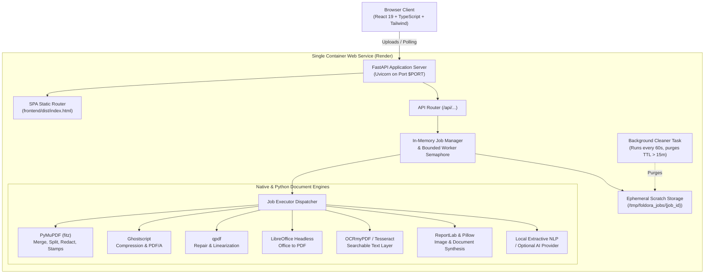

# Foldora PDF

> “Every document. One smoother workflow.”

Foldora PDF is an independent, production-oriented, full-stack online PDF utility suite featuring an original brand identity, bespoke UI/UX architecture, privacy-first ephemeral processing, and zero permanent document storage.

Deployable on **Render** as a single Docker-based web service.

---

## 1. Architectural Highlights

- **Guest-First Workflow**: No account registration, paywalls, or newsletters required.
- **Zero Permanent Storage**: Documents reside only in container scratch directories and are eradicated 15 minutes after job completion.
- **Native Document Engines**: Operations run real binary pipelines via PyMuPDF, Ghostscript, qpdf, LibreOffice headless, and Tesseract/OCRmyPDF.
- **Single-Origin Deployment**: FastAPI serves both high-throughput asynchronous API endpoints and the compiled React 19 single-page application (SPA).
- **Subprocess Security**: Native binaries run through controlled subprocess calls with strict timeouts, zero shell interpolation (`shell=False`), and binary magic-byte verification.

---

## 2. System Architecture



---

## 3. Tool Catalogue (64 Modules Across 8 Categories)

| Category | Available Modules |
| :--- | :--- |
| **A. Organize PDF** | Merge PDF, Split PDF, Organize Pages, Extract Pages, Remove Pages, Rotate PDF, Add Page Numbers, Crop PDF |
| **B. Optimize & Repair** | Compress PDF (Low/Recommended/High), Repair PDF, OCR PDF, Flatten PDF, PDF to PDF/A |
| **C. Convert to PDF** | Word to PDF, PowerPoint to PDF, Excel to PDF, JPG to PDF, PNG to PDF, WebP to PDF, TIFF to PDF, Multiple Images to PDF, Text to PDF, Markdown to PDF, HTML to PDF, Scan to PDF |
| **D. Convert from PDF**| PDF to JPG, PDF to PNG, PDF to Word (DOCX), PDF to Excel (XLSX), PDF to PowerPoint (PPTX), PDF to Text, PDF to HTML, PDF to Markdown, Extract Text, Extract Tables, Extract Images |
| **E. Edit & Annotate** | Add Text, Add Images, Highlight Text, Underline & Strikethrough, Draw Freehand, Add Shapes, Add Comments, Add Watermark, Add Header & Footer, Crop Margins, Fill Form Fields, Flatten Form, Annotate PDF, Add Custom Stamps |
| **F. Sign PDF** | Create Signature (Draw/Type/Upload), Sign PDF, Fill & Sign |
| **G. Security & Privacy**| Protect PDF (AES-256), Unlock PDF, Redact PDF (Permanent Byte Scrubbing), Remove Metadata, Compare PDFs, PDF Information, Check Integrity |
| **H. AI & Insights** | PDF Summarizer, Ask Questions About PDF, Translate PDF Text, Extract Structured Data |

---

## 4. Repository Structure

```
FOLDORA_PDF/
├── app/
│   ├── main.py                     # FastAPI app, lifespan, CORS, static mounting
│   ├── api/
│   │   └── routes.py               # /api/tools, /api/jobs, /api/previews, /healthz
│   ├── core/
│   │   ├── config.py               # Pydantic BaseSettings & limits
│   │   └── security.py             # Subprocess runner, magic bytes, sanitized paths
│   ├── jobs/
│   │   ├── models.py               # Job, OutputFile, ToolDefinition schemas
│   │   ├── manager.py              # In-memory registry & async background cleanup
│   │   └── executor.py             # Master dispatcher for all 64 tools
│   ├── services/
│   │   ├── tool_registry.py        # Central tool metadata directory
│   │   ├── pdf/organize.py         # Merge, split, rotate, crop, page numbers
│   │   ├── compression/compress.py # Ghostscript & PyMuPDF compression, repair
│   │   ├── conversion/             # To PDF & From PDF converters
│   │   ├── editing/editor.py       # Watermarks, stamps, text, shapes, forms
│   │   ├── security/               # AES protection, byte redaction, diff compare
│   │   ├── ocr/ocr_service.py      # Tesseract & OCRmyPDF integration
│   │   └── ai/ai_service.py        # Extractive summarizer, Q&A, structured parser
│   └── utils/
│       └── file_utils.py           # Directory cleanup, zip packing, format bytes
├── frontend/                       # React 19 + TypeScript + Vite + Tailwind CSS
│   ├── src/
│   │   ├── components/             # Layout, ToolCard, ToolGrid, Workspace components
│   │   ├── pages/                  # Home, ToolsDirectory, ToolWorkspace, About, Privacy
│   │   ├── services/api.ts         # Type-safe API client & polling
│   │   └── types/index.ts          # Frontend TypeScript types
│   ├── package.json
│   └── vite.config.ts
├── tests/                          # Automated backend & API test suite
│   ├── test_pdf_operations.py      # Direct service operation tests
│   └── test_api.py                 # FastAPI TestClient endpoint tests
├── Dockerfile                      # Multi-stage Docker build (Node 22 + Python 3.11-slim)
├── render.yaml                     # Render Blueprint specification
├── requirements.txt                # Python backend dependencies
├── .env.example                    # Environment template
└── README.md
```

---

## 5. Prerequisites

- **Python**: 3.11+
- **Node.js**: 20+ (with `npm`)
- **Docker** (optional for local container testing)
- **Native Tools** (for full offline conversions): `ghostscript`, `qpdf`, `libreoffice`, `tesseract-ocr`. *(Note: All native tools are pre-configured automatically inside the Docker build!)*

---

## 6. Local Development Setup

### 1. Backend Setup
```bash
# Create and activate virtual environment
python -m venv .venv
source .venv/bin/activate    # On Windows: .\.venv\Scripts\Activate.ps1

# Install dependencies
pip install -r requirements.txt

# Start backend development server
uvicorn app.main:app --reload --host 127.0.0.1 --port 8000
```

### 2. Frontend Setup
```bash
cd frontend

# Install Node dependencies
npm install

# Start Vite dev server (proxies /api to localhost:8000)
npm run dev
```

Visit `http://localhost:3000` to interact with the frontend connected to your local backend.

---

## 7. Running the Automated Tests

The test suite validates PDF manipulation, structural repair, compression metrics, password protection, permanent redaction, and API endpoints using generated fixtures.

```bash
pytest tests -v -o pythonpath=.
```

---

## 8. Docker Build & Local Container Run

Build and run the unified multi-stage container locally:

```bash
# Build Docker image
docker build -t foldora-pdf .

# Run container binding to port 10000
docker run -p 10000:10000 -e PORT=10000 foldora-pdf
```

Test the container health check:
```bash
curl http://localhost:10000/healthz
```

---

## 9. Deploying to Render from GitHub

1. Push your repository to GitHub.
2. Sign in to your [Render Dashboard](https://dashboard.render.com).
3. Click **New +** → **Blueprint** (or connect your repo using the `render.yaml` file).
4. Alternatively, create a **Web Service**:
   - **Environment**: Docker
   - **Branch**: main
   - **Region**: Oregon or Frankfurt
   - **Health Check Path**: `/healthz`
   - **Plan**: Free or Starter
5. Click **Create Web Service**. Render will execute the multi-stage Docker build, compile the frontend assets, set up the native PDF libraries, and bind to Render's dynamic `$PORT`.

---

## 10. Environment Variables

| Variable | Default | Purpose |
| :--- | :--- | :--- |
| `PORT` | `10000` | Port assigned by Render or local container host. |
| `MAX_UPLOAD_MB` | `50` | Maximum file size in megabytes per document. |
| `MAX_FILES_PER_JOB` | `20` | Maximum number of files processed in a single batch. |
| `MAX_PAGES_PER_JOB` | `200` | Maximum page count ceiling to prevent memory exhaustion. |
| `MAX_CONCURRENT_JOBS` | `5` | Semaphore bounding simultaneous CPU-intensive tasks. |
| `JOB_TTL_MINUTES` | `15` | Minutes output files remain available before auto-wipe. |
| `MAX_PROCESSING_SECONDS` | `180` | Subprocess timeout limit. |
| `AI_PROVIDER` | *(empty)* | Optional external AI provider (`openai`, `gemini`, `ollama`). |
| `AI_API_KEY` | *(empty)* | API key for external AI provider. |
| `AI_MODEL` | *(empty)* | Target AI model name (e.g., `gpt-4o-mini`). |

---

## 11. Known Conversion Limitations & Transparency

- **Complex Word/Excel Layouts**: LibreOffice headless produces high-fidelity conversions for most documents; however, proprietary fonts not bundled in the OS may fallback to metric-compatible open fonts (Liberation, DejaVu).
- **Encrypted Files**: Files protected with unknown passwords cannot be bypassed. Foldora strictly rejects brute-force attacks.
- **Scanned Text**: If a scanned document is photographed with extreme skew or low illumination, OCR recognition accuracy may vary.
- **AI Tools**: When no `AI_API_KEY` is provided, tools like PDF Summarizer transparently use our local frequency-weighted extractive NLP algorithm, ensuring 100% functionality without external subscriptions.

---

## 12. Instructions for Adding a New Tool

1. Register the tool definition in `app/services/tool_registry.py` under the appropriate `ToolCategory`.
2. Add the processing subroutine in `app/services/` (e.g. `app/services/pdf/`).
3. Add the dispatch branch in `app/jobs/executor.py` inside `execute_job()`.
4. (Optional) Customize tool-specific options in `frontend/src/components/workspace/ToolOptionsForm.tsx`.
5. Add a corresponding test case in `tests/test_pdf_operations.py`.

---

## 13. License

Released under the MIT License. Built with open-source tools.
