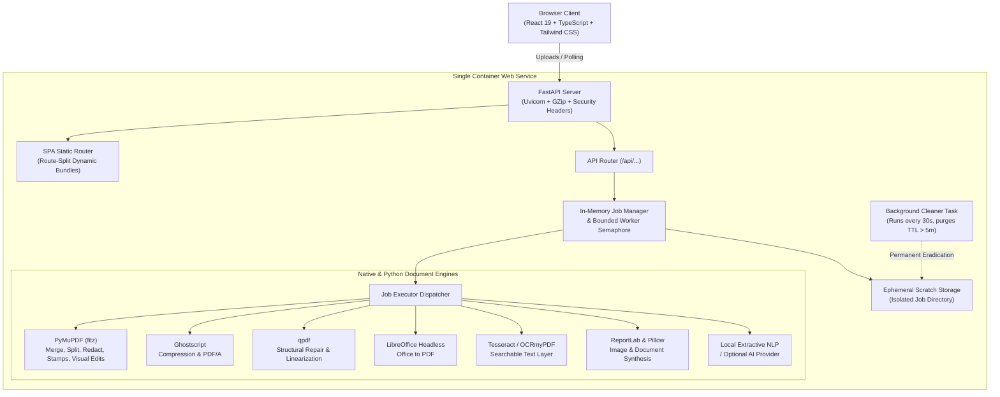

# Foldora PDF

> “Every document. One smoother workflow.”

Foldora PDF is an independent, production-grade, full-stack online PDF utility suite featuring an original brand identity, responsive UI/UX architecture, privacy-first ephemeral document processing, and zero permanent file retention.

Deployable on **Render** (or any container platform) as a single Docker-based web service.

---

## 1. Architectural & Privacy Highlights

- **Guest-First Workflow**: No account registration, credentials, paywalls, or marketing tracking required.
- **Zero Permanent Storage**: Files are written strictly to isolated ephemeral container scratch directories and permanently wiped **5 minutes** after job completion.
- **Immediate User Purge**: Users can trigger instant 0-second file eradication via the *"Delete temporary files now"* button or by processing another document.
- **Native Document Processing Engines**: All conversions, repairs, and transformations run through high-performance binary engines including PyMuPDF, Ghostscript, qpdf, headless LibreOffice, and Tesseract OCR.
- **Optimized Network Delivery**: FastAPI is configured with on-the-fly GZip compression for all payloads $\ge 500$ bytes, long-term immutable browser caching for static assets, and route-level dynamic code-splitting (reducing initial JS bundle size to ~24 kB).
- **Subprocess Security**: Native executables run with strict timeouts, zero shell interpolation (`shell=False`), and magic-byte type verification to defend against file disguise attacks.
- **Security Headers (Defense-in-Depth)**: Standard OWASP security headers (`X-Content-Type-Options: nosniff`, `X-Frame-Options: DENY`, `Referrer-Policy: strict-origin-when-cross-origin`, `Permissions-Policy: camera=(), microphone=(), geolocation=()`) are enforced on all HTTP responses.

---

## 2. System Architecture



---

## 3. Tool Catalogue (60+ Modules Across 8 Categories)

| Category | Available Modules |
| :--- | :--- |
| **A. Organize PDF** | Merge PDF, Split PDF, Organize Pages, Extract Pages, Remove Pages, Rotate PDF, Add Page Numbers, Crop PDF |
| **B. Optimize & Repair** | Compress PDF (Low / Recommended / High), Repair PDF, OCR PDF, Flatten PDF, PDF to PDF/A |
| **C. Convert to PDF** | Word to PDF, PowerPoint to PDF, Excel to PDF, JPG to PDF, PNG to PDF, WebP to PDF, TIFF to PDF, Multiple Images to PDF, Text to PDF, Markdown to PDF, HTML to PDF, Scan to PDF |
| **D. Convert from PDF**| PDF to JPG, PDF to PNG, PDF to Word (DOCX), PDF to Excel (XLSX), PDF to PowerPoint (PPTX), PDF to Text, PDF to HTML, PDF to Markdown, Extract Text, Extract Tables, Extract Images |
| **E. Edit & Annotate** | Edit PDF (Visual in-place text editor & canvas annotations), Add Text, Add Images, Highlight Text, Underline & Strikethrough, Draw Freehand, Add Shapes, Add Comments, Add Watermark, Add Header & Footer, Crop Margins, Fill Form Fields, Flatten Form, Annotate PDF, Add Custom Stamps |
| **F. Sign PDF** | Create Signature (Draw / Type / Upload), Sign PDF, Fill & Sign |
| **G. Security & Privacy**| Protect PDF (AES-256), Unlock PDF, Redact PDF (Permanent Byte Scrubbing), Remove Metadata, Compare PDFs, PDF Information, Check Integrity |
| **H. AI & Insights** | PDF Summarizer, Ask Questions About PDF, Translate PDF Text, Extract Structured Data |

---

## 4. Security & Privacy Model

Foldora PDF operates under a strict zero-knowledge document handling model:

1. **No Persistent Database**: The platform does not use any database to store documents, user profiles, or file metadata.
2. **Ephemeral Scratch Files**: Uploaded documents and generated outputs exist exclusively within temporary scratch storage and are completely purged after **5 minutes** or upon manual user request.
3. **In-Memory Credential Handling**: For operations requiring passwords (such as **Protect PDF** or **Unlock PDF**), credentials are passed in-memory directly to cryptographic subroutines (AES-256) and are never logged or stored.
4. **Permanent Redaction**: The Redact tool uses PyMuPDF's C-level stream sanitization to permanently erase targeted text and vectors from the underlying PDF syntax, rather than simply drawing an overlay.
5. **Single-Use Download Tokens**: Download URLs are cryptographically protected via randomized tokens generated with Python's `secrets` module, preventing unauthorized file enumeration.

---

## 5. Repository Structure

```
FOLDORA_PDF/
├── app/
│   ├── main.py                     # FastAPI app, lifespan, CORS, GZip, security headers
│   ├── api/
│   │   └── routes.py               # /api/tools, /api/jobs, /api/previews, /healthz
│   ├── core/
│   │   ├── config.py               # Pydantic BaseSettings & operational limits
│   │   └── security.py             # Subprocess runner, magic bytes, sanitized paths
│   ├── jobs/
│   │   ├── models.py               # Job, OutputFile, ToolDefinition schemas
│   │   ├── manager.py              # In-memory registry & 30s background cleanup
│   │   └── executor.py             # Master dispatcher for all tools
│   ├── services/
│   │   ├── tool_registry.py        # Central tool metadata directory
│   │   ├── pdf/organize.py         # Merge, split, rotate, crop, page numbers
│   │   ├── compression/compress.py # Ghostscript & PyMuPDF compression, repair
│   │   ├── conversion/             # Document converters (To PDF & From PDF)
│   │   ├── editing/editor.py       # Visual edits, watermarks, stamps, text, shapes
│   │   ├── security/               # AES protection, byte redaction, diff compare
│   │   ├── ocr/ocr_service.py      # Tesseract integration
│   │   └── ai/ai_service.py        # Extractive summarizer, Q&A, structured parser
│   └── utils/
│       ├── file_utils.py           # Directory cleanup, zip packing, format bytes
│       └── memory.py               # GC collection & Linux malloc_trim memory relief
├── frontend/                       # React 19 + TypeScript + Vite + Tailwind CSS
│   ├── src/
│   │   ├── components/             # Layout, ToolCard, ToolGrid, Workspace, VisualEditor
│   │   ├── pages/                  # Route-split views (Home, Directory, Workspace, Legal)
│   │   ├── services/api.ts         # Type-safe API client & polling
│   │   └── types/index.ts          # TypeScript type definitions
│   ├── package.json
│   └── vite.config.ts              # Code splitting & vendor chunking
├── tests/                          # Automated backend & API test suite (23 tests)
│   ├── test_pdf_operations.py      # PDF operation & conversion tests
│   └── test_api.py                 # Endpoint, security, and cleanup lifecycle tests
├── Dockerfile                      # Multi-stage Docker build (Node 22 + Python 3.11-slim)
├── render.yaml                     # Render Blueprint specification
├── requirements.txt                # Python backend dependencies
├── .env.example                    # Environment template
└── README.md
```

---

## 6. Prerequisites

- **Python**: 3.11+
- **Node.js**: 20+ (with `npm`)
- **Docker** (optional for local container testing)
- **Native Tools** (for full offline conversions): `ghostscript`, `qpdf`, `libreoffice`, `tesseract-ocr`. *(All native tools are pre-installed in the Docker image)*

---

## 7. Local Development Setup

### 1. Backend Setup
```bash
# Create and activate virtual environment
python -m venv .venv
source .venv/bin/activate    # On Windows: .\.venv\Scripts\Activate.ps1

# Install dependencies
pip install -r requirements.txt

# Start backend development server
uvicorn app.main:app --reload --host 127.0.0.1 --port 8000
```

### 2. Frontend Setup
```bash
cd frontend

# Install Node dependencies
npm install

# Start Vite dev server (proxies /api to localhost:8000)
npm run dev
```

Visit `http://localhost:3000` to interact with the frontend connected to your local backend.

---

## 8. Running the Automated Tests

The test suite validates PDF manipulation, structural repair, compression metrics, password protection, byte-level redaction, security headers, and the 5-minute auto-wipe lifecycle.

```bash
pytest tests -v -o pythonpath=.
```

---

## 9. Docker Build & Local Container Run

Build and run the unified multi-stage container locally:

```bash
# Build Docker image
docker build -t foldora-pdf .

# Run container binding to port 10000
docker run -p 10000:10000 -e PORT=10000 foldora-pdf
```

Test the container health check:
```bash
curl http://localhost:10000/healthz
```

---

## 10. Deploying to Render from GitHub

1. Push your repository to GitHub.
2. Sign in to your [Render Dashboard](https://dashboard.render.com).
3. Click **New +** → **Blueprint** and select your repository to deploy using `render.yaml`.
4. Alternatively, create a **Web Service**:
   - **Environment**: Docker
   - **Branch**: main
   - **Health Check Path**: `/healthz`
   - **Plan**: Starter
5. Render will automatically execute the multi-stage Docker build, compile frontend assets, configure native PDF dependencies, and start the application.

---

## 11. Environment Configuration

| Variable | Default | Purpose |
| :--- | :--- | :--- |
| `PORT` | `10000` | Port assigned by the hosting environment or local container host. |
| `MAX_UPLOAD_MB` | `35` | Maximum file size in megabytes per uploaded document. |
| `MAX_FILES_PER_JOB` | `20` | Maximum number of files processed in a single batch. |
| `MAX_PAGES_PER_JOB` | `100` | Maximum page count ceiling to prevent memory exhaustion. |
| `MAX_CONCURRENT_JOBS` | `2` | Bounded worker semaphore for CPU-intensive processing tasks. |
| `JOB_TTL_MINUTES` | `5` | Minutes output files remain available before automated wipe. |
| `CLEANUP_INTERVAL_SECONDS`| `30` | Interval between background sweeps for expired temporary jobs. |
| `MAX_PROCESSING_SECONDS` | `180` | Subprocess timeout limit. |
| `AI_PROVIDER` | *(empty)* | Optional external AI provider (`openai`, `gemini`, `ollama`). |
| `AI_API_KEY` | *(empty)* | API key for external AI provider (optional). |
| `AI_MODEL` | *(empty)* | Target AI model identifier (e.g. `gpt-4o-mini`). |

---

## 12. Conversion Limitations & Transparency

- **Office Document Layouts**: Headless LibreOffice provides high-fidelity conversion for standard documents; specialized proprietary fonts not installed in the container OS fallback to metric-compatible open fonts (Liberation, DejaVu).
- **Password-Protected Files**: Foldora strictly rejects brute-force attacks. Encrypted documents require the valid user password.
- **AI Processing**: When no external AI key is configured, analytical tools automatically utilize Foldora's built-in local extractive NLP algorithm with zero third-party data transmission.

---

## 13. License

Released under the [MIT License](LICENSE).
